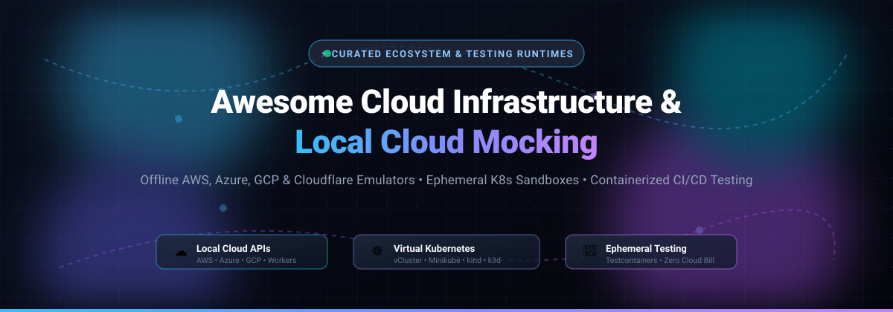

# ☁️ Awesome Cloud Infrastructure & Local Cloud Mocking

  

  
  
  
  
  
  

---

## 🚀 Top Cloud Infrastructure & Local Cloud Mocking Ecosystem

> ⚡ **Curated List of SaaS/Hosted Platforms & Open-Source GitHub Projects**  
> 🌐 *Focused on Local Cloud Mocking (AWS / Azure / GCP / Cloudflare), Ephemeral Infrastructure Testing, Containerized Test Environments & Virtual Kubernetes Clusters*  
> 📅 **Last updated: November 2026**

This repository tracks notable **SaaS/hosted platforms** and **open-source projects** for **Cloud Infrastructure & Local Cloud Mocking**. These tools mock, emulate, provision, and test cloud provider APIs, storage/queue services, Kubernetes clusters, and isolated ephemeral environments locally and in CI/CD pipelines without incurring live cloud costs, egress fees, or network latency.

Key tools include **LocalStack Cloud**, **Serverless Framework**, **Testcontainers Cloud**, **DevZero**, **Gitpod (Ona)**, **Okteto**, **Daytona**, **vCluster**, and **floci-io/floci**.

Whether you are building microservices on AWS/Azure/GCP, validating Infrastructure-as-Code (Terraform / OpenTofu), or debugging containerized cloud workflows, this guide outlines both commercial SaaS platforms and leading open-source options.

---

## 📑 Table of Contents

- [📊 Sector Overview & Market Dynamics](#-sector-overview--market-dynamics)
- [🏢 SaaS/Hosted Platforms](#-saashosted-platforms)
- [💻 Open-Source GitHub Projects](#-open-source-github-projects)
- [🛠️ Frameworks & Architecture Patterns](#️-frameworks--architecture-patterns)
- [📈 Star History](#-star-history)
- [🤝 How to Contribute](#-how-to-contribute)
- [💖 Support & Share](#-support--share)
- [⚠️ Disclaimer](#️-disclaimer)

---

## 📊 Sector Overview & Market Dynamics

The global cloud infrastructure testing and emulation market is valued at approximately **$13B–$15B** (projected to reach **$30B–$45B** by the early 2030s at an ~11–13% CAGR), driven by multi-cloud complexity, microservices shift-left testing, and AI container workloads. The sector remains **highly fragmented** across specialized cloud mockers, local virtual Kubernetes runtimes, and remote container test runners, with hyper-scalers and developer-platform leaders (e.g., Docker, OpenAI) selectively acquiring key category innovators rather than a single winner-take-all monopoly.

---

## 🏢 SaaS/Hosted Platforms

| Platform | Company Size (Valuation / Revenue) | Pricing (Starting Tier) | Free Tier Limits | Description |
| :--- | :--- | :--- | :--- | :--- |
| **[Testcontainers Cloud (Docker)](https://testcontainers.com)** | ~$2.1B Valuation / ~$165M ARR (Docker acquired AtomicJar) | $9/user/month (Docker Pro billed annually; includes 100 cloud runtime mins) | Free Tier (Personal): 50 lifetime one-time worker minutes & 1 concurrent CI session; libraries free locally | Serverless on-demand container runtime offloading heavy Testcontainers integration tests and local cloud emulators from developer laptops and CI runners to the cloud. |
| **[Gitpod (Ona)](https://gitpod.io)** | ~$41M Funding / ~$5M ARR (Acquired by OpenAI in 2026) | $9/user/month (Pay-As-You-Go tier with baseline 1,000 credits) | 500 credits/month (up to 50 workspace hours/month) for public repositories and individuals | Cloud Development Environment (CDE) platform automating ephemeral, standardized cloud infrastructure workspaces for developers and AI agents directly from Git. |
| **[LocalStack Cloud / Pro](https://localstack.cloud)** | ~$100M–$250M Valuation (est.) / $28.2M Total Raised / ~$5M+ ARR | $39/license/month (Base Team tier billed annually) | Permanent Community/Hobby plan: Core AWS emulation free for non-commercial usage; 14-day free trial on Pro | Commercial cloud testing and team collaboration platform extending open-source LocalStack with Cloud Pods state snapshots, CI analytics, IAM policy enforcement, and extended AWS service coverage. |
| **[vCluster Cloud / Loft Labs](https://vcluster.com)** | ~$75M–$100M Valuation (est.) / $28.6M Total Raised / 4.6x YoY ARR | Custom enterprise quotes (pricing tied to vCPU/GPU compute consumption rather than seat licenses) | Permanent Free Platform Tier: Unlimited tenant clusters up to 64 vCPUs or 32 GPUs & 1 HA virtual control plane | Enterprise control plane for provisioning multi-tenant virtual Kubernetes clusters, sleep-mode cost optimization, and self-service developer namespaces. |
| **[DevZero](https://devzero.io)** | ~$50M–$80M Valuation (est.) / $26M Total Raised | $5/CPU/month (Pro tier tracked at minute-level granularity across fleet) | Permanent Free Tier: Unlimited K8s clusters, resource/cost monitoring, multi-cloud governance, and 30-day data retention | Managed cloud infrastructure platform delivering production-like Kubernetes and VM environments with instant hot-reloading and database branching. |
| **[Okteto Cloud](https://okteto.com)** | ~$60M Valuation / $18.1M Total Raised / ~$5M ARR | Custom quote per user seat (Scale tier for teams; contact sales for pricing) | Permanent Free Starter Plan: Up to 5 users and 500 environments/month on self-hosted Kubernetes | Cloud-native development platform enabling teams to deploy, test, and preview microservices inside realistic remote Kubernetes namespaces. |
| **[Serverless Framework (Serverless Inc. Cloud)](https://serverless.com)** | ~$30M–$50M Valuation (est.) / $13M Total Raised / ~$1.5M ARR | $4/credit (Starter credit bundles begin at ~$114–$142/month for commercial users) | Permanent Free Tier: 100% free for all developers and organizations with under $2M annual revenue | Managed cloud deployment, monitoring, and multi-stage orchestration platform for AWS Lambda, API Gateway, and event-driven cloud infrastructure. |
| **[Minikube Cloud / Managed K8s Sandboxes (KillerCoda / Instruqt)](https://killercoda.com)** | ~$5M–$15M Market footprint (KillerCoda bootstrapped / Instruqt raised $18M+) | KillerCoda PLUS at $9.99/month; Instruqt custom annual packages starting ~$15,000/year (~1,000 lab hrs) | KillerCoda Free Tier: 1 concurrent scenario, max 1 hour per session on community playgrounds; Instruqt: vendor-guided PoC trial only | Browser-hosted interactive Kubernetes and cloud-native lab environments for running isolated infrastructure sandboxes with zero local setup. |
| **[Codeanywhere](https://codeanywhere.com)** | ~$2M–$5M Historical Valuation / ~$1M Total Raised / Wound Down (2026) | Historical: $12/month (Basic tier); platform ceased operations July 1, 2026 | Historical: 7-day free trial (up to 1 container); service currently wound down / redirected to Daytona | Browser-based cloud IDE and container workspace service providing instant SSH, Git, and DevContainer infrastructure from any device. |

---

## 💻 Open-Source GitHub Projects

*Sorted in descending order by GitHub stargazers count.*

1. **[Daytona](https://github.com/daytonaio/daytona)**   
   📦 `daytonaio/daytona`  
   Open-source Development Environment Manager and secure elastic runtime for provisioning standardized local, remote, or AI-agent infrastructure sandboxes with a single command.

2. **[LocalStack](https://github.com/localstack/localstack)**   
   📦 `localstack/localstack`  
   Flagship open-source cloud service emulator running inside a single Docker container to mock core AWS infrastructure (S3, Lambda, DynamoDB, SQS, SNS, IAM, CloudFormation) locally.

3. **[MinIO](https://github.com/minio/minio)**   
   📦 `minio/minio`  
   High-performance open-source, S3-compatible object storage server widely used to mock AWS S3 buckets, presigned URLs, and event notifications locally.

4. **[k3s](https://github.com/k3s-io/k3s)**   
   📦 `k3s-io/k3s`  
   Lightweight, fully compliant certified Kubernetes distribution packaged in a single binary (<100MB), ideal for local dev, edge computing, and offline staging clusters.

5. **[Minikube](https://github.com/kubernetes/minikube)**   
   📦 `kubernetes/minikube`  
   Official open-source tool for running local single-node and multi-node Kubernetes clusters across macOS, Linux, and Windows via Docker, QEMU, or KVM.

6. **[floci-io/floci](https://github.com/floci-io/floci)**   
   📦 `floci-io/floci`  
   Open-source local cloud mocking and infrastructure simulation toolkit engineered for fast, lightweight offline cloud API emulation and reproducible testing workflows.

7. **[OpenTofu](https://github.com/opentofu/opentofu)**   
   📦 `opentofu/opentofu`  
   Open-source, community-driven Infrastructure as Code (IaC) tool under Linux Foundation for provisioning local cloud emulators, Docker networks, and K8s clusters.

8. **[OpenFaaS](https://github.com/openfaas/faas)**   
   📦 `openfaas/faas`  
   Open-source serverless framework for Kubernetes and Docker enabling developers to emulate and test event-driven FaaS functions locally without cloud vendor lock-in.

9. **[Pulumi](https://github.com/pulumi/pulumi)**   
   📦 `pulumi/pulumi`  
   Universal Infrastructure-as-Code SDK using real programming languages (TypeScript, Python, Go, C#) supporting direct local deployments against LocalStack and local K8s.

10. **[Coder](https://github.com/coder/coder)**   
    📦 `coder/coder`  
    Open-source cloud development environment (CDE) platform provisioned via Terraform templates on self-hosted Kubernetes, Docker, or bare metal.

11. **[kind (Kubernetes in Docker)](https://github.com/kubernetes-sigs/kind)**   
    📦 `kubernetes-sigs/kind`  
    Fast open-source tool for running local Kubernetes clusters using Docker container "nodes," purpose-built for testing K8s controllers and CI/CD pipelines.

12. **[DevPod](https://github.com/loft-sh/devpod)**   
    📦 `loft-sh/devpod`  
    Open-source, client-only DevContainer orchestrator that turns any cloud VM, local Docker daemon, or Kubernetes cluster into a reproducible dev environment.

13. **[vCluster](https://github.com/loft-sh/vcluster)**   
    📦 `loft-sh/vcluster`  
    Popular open-source virtual Kubernetes cluster engine that spins up isolated, certified K8s control planes inside regular namespaces of a shared host cluster.

14. **[Testcontainers](https://github.com/testcontainers/testcontainers-java)**   
    📦 `testcontainers/testcontainers-java` (also available for Go, Python, Node, .NET)  
    Industry-standard open-source library providing programmatic, throwaway Docker instances of databases, message brokers, and LocalStack directly inside unit and integration tests.

15. **[Moto](https://github.com/getmoto/moto)**   
    📦 `getmoto/moto`  
    Widely adopted open-source Python library mocking over 100 AWS services via decorators or a standalone HTTP server mode for fast offline unit testing.

16. **[WireMock](https://github.com/wiremock/wiremock)**   
    📦 `wiremock/wiremock`  
    Popular open-source tool for stubbing and mocking HTTP APIs, external microservices, and third-party REST endpoints in local and automated test suites.

17. **[AWS SAM CLI](https://github.com/aws/aws-sam-cli)**   
    📦 `aws/aws-sam-cli`  
    Official AWS CLI tool for locally developing, testing, and debugging serverless applications defined by AWS Serverless Application Model (SAM) templates.

18. **[k3d](https://github.com/k3d-io/k3d)**   
    📦 `k3d-io/k3d`  
    Lightweight open-source wrapper to run Rancher Lab's k3s in Docker, enabling multi-node local Kubernetes clusters spun up in under 5 seconds.

19. **[Serverless Offline](https://github.com/dherault/serverless-offline)**   
    📦 `dherault/serverless-offline`  
    Serverless Framework plugin that emulates AWS Lambda and API Gateway locally on your computer to speed up local development cycles.

20. **[Miniflare (Cloudflare Workers SDK)](https://github.com/cloudflare/workers-sdk)**   
    📦 `cloudflare/workers-sdk` (Miniflare / Wrangler)  
    Full-featured open-source local simulator for Cloudflare Workers, KV, R2, D1, Durable Objects, and Queues powered by `workerd`.

21. **[Firebase Local Emulator Suite](https://github.com/firebase/firebase-tools)**   
    📦 `firebase/firebase-tools`  
    Official local emulator suite for Google Cloud Firestore, Realtime Database, Cloud Functions, Auth, and Storage.

22. **[Azurite](https://github.com/Azure/Azurite)**   
    📦 `Azure/Azurite`  
    Official open-source cross-platform emulator for Microsoft Azure Storage (Blob, Queue, and Table) enabling local offline cloud development.

23. **[fake-gcs-server](https://github.com/fsouza/fake-gcs-server)**   
    📦 `fsouza/fake-gcs-server`  
    Lightweight, standalone emulator for Google Cloud Storage (GCS) providing a local HTTP server and Docker image for integration tests.

---

## 🛠️ Frameworks & Architecture Patterns

Combine these open-source tools to build an offline, production-grade cloud development feedback loop:

- **Offline Cloud Emulation**: Combine `LocalStack`, `Moto`, or `floci-io/floci` with `OpenTofu` or `Pulumi` for offline Infrastructure-as-Code dry runs.
- **Microservices & Integration Tests**: Use `Testcontainers` alongside `WireMock` and `MinIO` for programmatic, containerized test execution in CI/CD runners without live cloud keys.
- **Isolated Multi-Tenant Kubernetes**: Leverage `vCluster` or `kind` / `k3d` to create zero-cost, disposable Kubernetes clusters on top of single-node host systems.

---

## 📈 Star History

---

## 🤝 How to Contribute

Contributions are warmly welcome! Help expand the curated ecosystem:

1. 🍴 **Fork the repository**.
2. 🌿 Create a new branch (`git checkout -b feature/add-new-tool`).
3. 📝 Add or update entries in `README.md` (keep descriptions factual, concise, and linked to official repositories).
4. 🚀 Submit a Pull Request with a clear explanation of your addition.

---

## 💖 Support & Share

Thank you for exploring and using **Awesome Cloud Infrastructure & Local Cloud Mocking**! If this repository helped streamline your development, saved testing costs, or introduced you to new tooling, please consider supporting the project:

- ⭐ **Star this repository** to help fellow developers and engineers discover it.
- 🍴 **Fork & Share** it with your engineering team, DevOps community, and on social channels.
- ☕ **Buy me a coffee / Sponsor** my open-source work via the [GitHub Sponsor Dashboard](https://github.com/sponsors/ishandutta2007) — every bit of sponsorship supports maintaining active, high-quality open-source ecosystem lists!

  

---

## ⚠️ Disclaimer

- This is an independent, community-curated list — not an official endorsement from cloud providers.
- Local cloud mocking tools approximate cloud provider APIs, IAM evaluation, and eventual consistency; always validate critical security, IAM policies, quotas, and architecture against actual staging cloud environments before production rollout.
- Self-hosted developer infrastructure requiring Docker socket access (`/var/run/docker.sock`) should always be configured with proper RBAC controls and network sandboxing.

---

  <b>Built with ❤️ for Cloud Architects, DevOps Engineers, and Backend Developers.</b>

